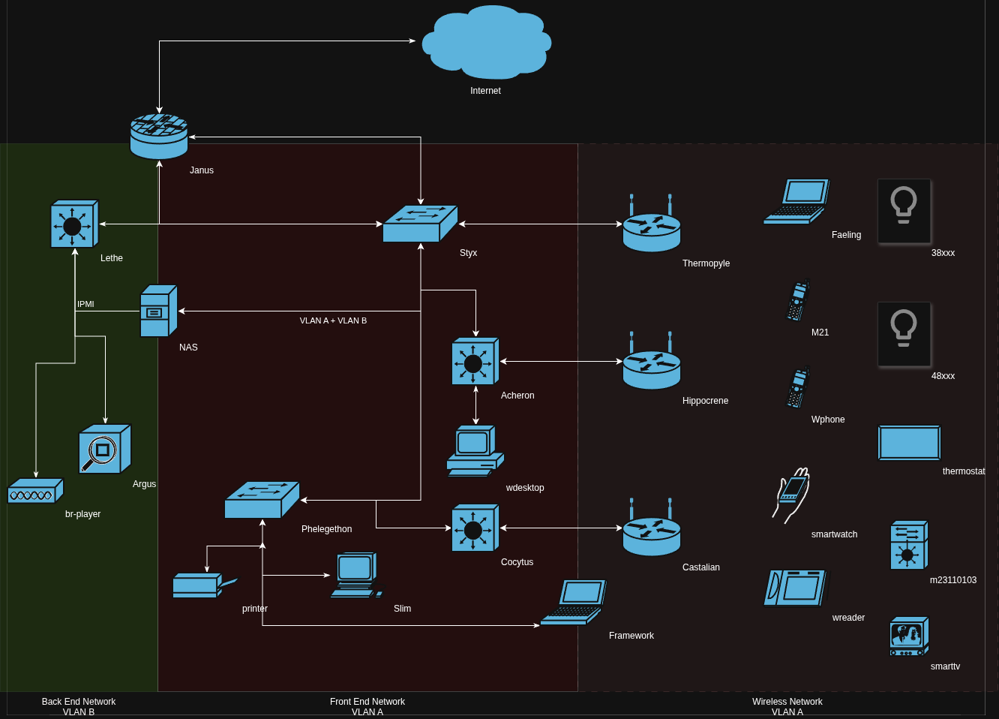

# Inventory

## Hardware
Network layout for the following devices is detailed in scope.md

### VLAN A

| Device name | Segment | Note |
| :---------- | :-----: | ---: |
| Janus | infrastructure | Dual homed network gateway |
| Styx | infrastructure | central switch |
| Thermopyle | infrastructure | Living room WiFi access point | 
| Cocytus | infrastructure | edge switch in exercise room| 
| nas | infrastructure | dual homed NAS server | 
| Phlegethon | infrastructure | workstation switch in main office | 
| Hippocrene | infrastructure | WiFi access point in second office | 
| Castalian | infrastructure | WiFi access point in exercise room | 
| Lethe | infrastructure | edge switch in media console |
| Archeron | infrastructure | edge port switch in second office |
| argus | infrastructure | network management server | 
| slim | infrastructure | workstation | 
| faeling | infrastructure | laptop | 
| M21 | infrastructure | cellphone | 
| wdesktop | infrastructure | desktop| 
| smartwatch | infrastructure | smart device |
| wreader | infrastructure | e-reader tablet |
| printer | infrastructure | inkjet Printer |
| Framework | infrastructure | laptop |
| 38xxx | infrastructure | Smart bulb - exterior |
| 48xxx | user1 | Smart bulb - reading lamp |
| m23110103 | user1 | Geothermal system |
| smartTV | user1 | Internet connected TV |
| Wphone | user1 | cellphone |
| thermostat  | user1 | smart Thermostat|

### VLAN B

| Device name | Segment | Note |
| :---------- | :-----: | ---: |
| freenas-backend | backend | Dual homed NAS server |
| freenas-ipmi | backend | IPMI for NAS server |
| br-player | backend | Blue-ray player |

### External Network

| Device name | Segment | Note |
| :---------- | :-----: | ---: |
| Janus | public | External gateway |
| mcloud | public | Externally available HTTPS Service | 

## User Accounts

Some details redacted for privacy

| Login | Device | Authentication method | Notes | 
| :---- | :----: | --------------------: | :---: |
| m\*\*   | slim | password or ssh key | password is ${m** variant #1} | 
| m\*\*   | Framework | password or ssh key | password is ${m** variant #1}
| m\*\*   | argus | password or ssh key | password is ${m** variant #1} | 
| m\*\*   | Janus | password (ssh key not currently possible) | password is ${m** variant #2} |
| m\*r\*\* | nas | password or ssh key | password is ${m** variant #1} |
| w\*\*   | faeling | password | password is ${w** variant #1} | 

File sharing from NAS 

| Login | Device | Authentication method | Notes | 
| :---- | :----: | --------------------: | :---: |
| m\*r\*\* | nas | password or ssh key | password is ${m** variant #1} User can also ssh into server |
| w\*\*   | nas | password | Used for mounting network shares only.  password is ${w** variant #1} |

## Software

| Name | Access | Note |
| :--- | :----: | :--- |
| Linux | User Login | |
| BSD OS | User Login | |
| MacOS | User Login | |
| BSD based router | User Login | |
| Linux based NAS | User Login | |
| Android OS | PIN | ${m** PIN variant #1} |
| Android OS | PIN | ${w** PIN variant #1} |
| iOS |  PIN | ${w** PIN variant #1} |
| Network control system | email password + MFA | centralized net device management |
| mcloud | nas | username/password or app token | externally accessible |
| Git repo | nas | username/password or ssh keys | internal access only |
| Smart bulbs | API key paired with phone app | Accessible on front end LAN |

## Notable Data Stores
* Archive of photography business photos on NAS
* Music library stored on NAS
* Archive of secrets on NAS (GPG Encrypted)
* System backups on NAS
* Configuration backup for NAS, on slim
